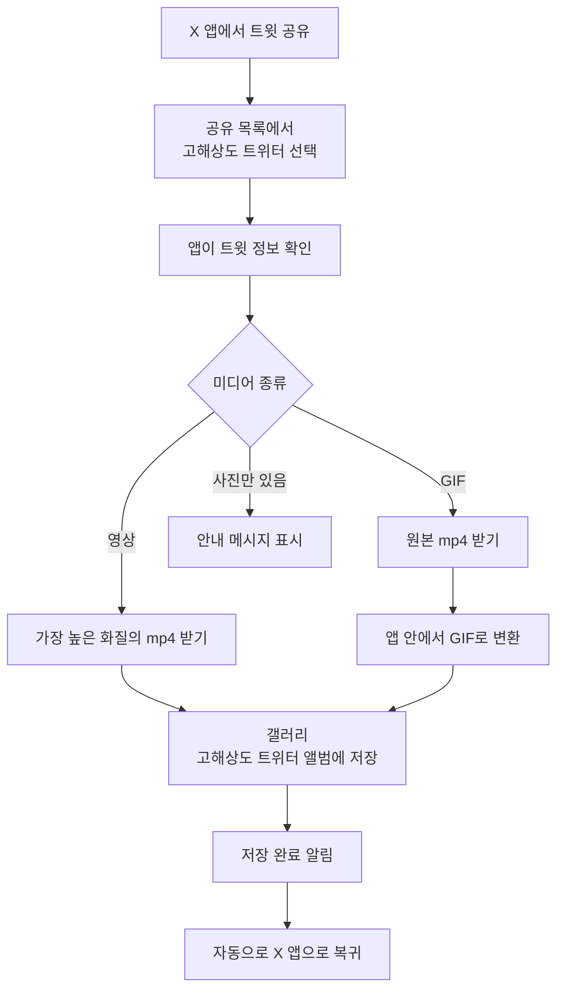
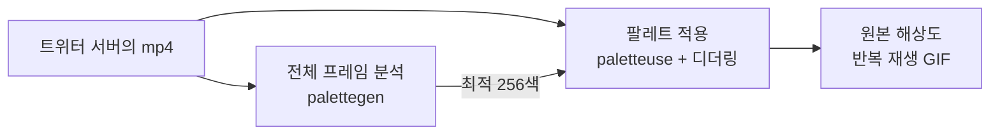
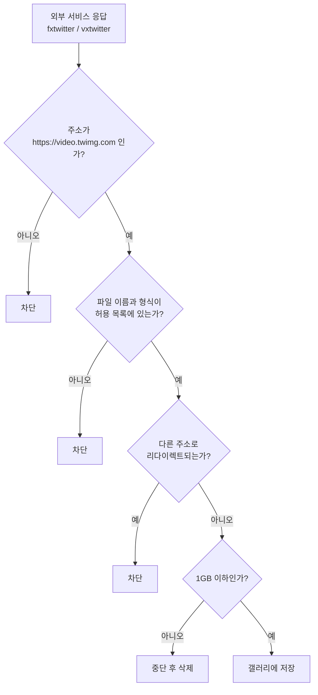
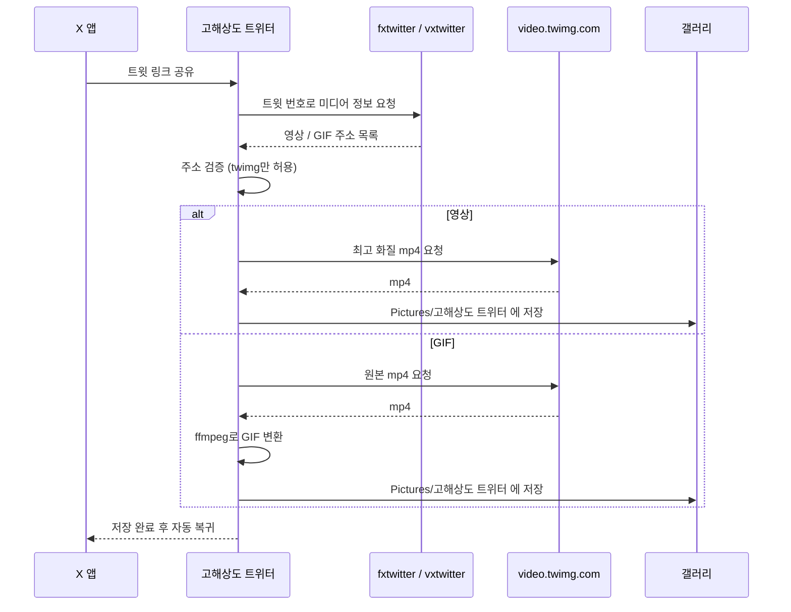

# 고해상도 트위터 (갤럭시용)

X(트위터)의 **영상은 최고 화질로, GIF는 화질 그대로 진짜 GIF로** 갤러리에 저장하는 안드로이드 앱입니다.
아이폰 단축어 [고해상도 트위터](https://gluebyte.notion.site/dffbebd3c25c4fd09a0fa77cb2ce1695)에서 아이디어를 얻은 갤럭시판입니다.

## 📥 다운로드

👉 **[최신 APK 받기](../../releases/latest)**

| 항목 | 값 |
|---|---|
| 버전 | 1.2 |
| 지원 | Android 10 이상 |
| 크기 | 약 13MB |
| APK SHA-256 | `b5e56980c54c380ed35dafeaca31212f5f62176a189404ce68182638b751fb66` |
| 서명 인증서 SHA-256 | `414278d8ad5881d475afb00d345674307bb513c96076e2190d8adc807afa1380` |

## ✨ 기능

- ✅ **영상:** 트위터가 제공하는 화질 중 가장 높은 화질로 저장
- ✅ **GIF:** mp4가 아닌 진짜 GIF로, 원본 해상도와 프레임 그대로 저장
- ✅ **갤러리 저장:** `고해상도 트위터` 앨범(`Pictures/고해상도 트위터`)에 모아서 저장
- ✅ **자동 복귀:** 저장이 끝나면 저절로 X 앱으로 돌아감
- ✅ **로그인 불필요:** X 계정을 연결하지 않아도 됨

## 📲 설치와 사용법

1. 위의 **최신 APK 받기**에서 `.apk` 파일을 받습니다.
2. 파일을 열고 **출처를 알 수 없는 앱 설치**를 허용한 뒤 설치합니다.
   Play 스토어 앱이 아니라서 설치할 때 경고가 뜰 수 있습니다.
3. X 앱에서 트윗의 **공유 → 공유하기 → 고해상도 트위터**를 누르면 끝입니다.

브라우저를 열어둘 필요는 없고, 인터넷(와이파이 또는 데이터)만 연결돼 있으면 됩니다.



## 🎞️ GIF가 깨지지 않는 이유

트위터는 사용자가 올린 GIF를 서버에서 **mp4 영상으로 바꿔서 보관**합니다. 그래서 그냥 받으면 영상 파일이 되고, 아무렇게나 GIF로 바꾸면 색이 뭉개집니다.

이 앱은 앱 안에 들어 있는 ffmpeg로 다음처럼 변환합니다.

- 원본 해상도와 프레임 간격을 그대로 유지
- 움짤 **전체 프레임을 분석해서 가장 잘 맞는 256색 팔레트**를 생성
- 디더링(sierra2_4a)으로 색 경계를 자연스럽게 처리
- 무한 반복 재생으로 저장



## 🔒 보안

이 앱은 받은 데이터를 믿지 않는 것을 기본으로 설계했습니다.

| 항목 | 내용 |
|---|---|
| 권한 | **인터넷 하나뿐.** 사진, 연락처, 위치, 저장소 읽기 권한이 없습니다. |
| 갤러리 | 안드로이드 기본 저장 방식(MediaStore)을 써서 **저장만 하고 기존 사진은 읽을 수 없습니다.** |
| 다운로드 주소 | 트위터 미디어 서버(`https://video.twimg.com`)의 파일만 받습니다. 다른 주소와 리다이렉트는 차단합니다. |
| 파일 검사 | 파일 이름(영문, 숫자, `_`만 허용), 형식(GIF, mp4만 허용), 크기(1GB 이하)를 앱이 직접 검사합니다. |
| 화면 이동 | 앱 화면은 앱에 내장된 페이지 밖으로 이동할 수 없습니다. 저장 기능은 내장 페이지에서만 호출됩니다. |
| 외부 코드 | GIF 변환기를 앱에 내장해서, 실행 중에 외부 코드를 받아 실행하지 않습니다. |
| 화면 표시 | 외부에서 받은 글자는 HTML로 해석하지 않아서, 트윗 내용에 코드를 넣어도 실행되지 않습니다. |
| 공유 입력 | 다른 앱이 보낸 텍스트는 길이를 제한하고 트윗 번호만 뽑아서 씁니다. |
| 기타 | 백업과 디버그 모드가 꺼져 있습니다. |



### 알아둘 점

- **비공개 계정**의 트윗은 받을 수 없습니다.
- 트윗에서 영상 주소를 알아내려고 무료 외부 서비스인 [fxtwitter](https://github.com/FxEmbed/FxEmbed)와 vxtwitter를 사용합니다. 이 서비스들에는 **트윗 번호와 접속 IP**가 전달됩니다.
- 두 서비스가 모두 중단되거나 X가 막으면 트윗을 불러오지 못합니다.
- 사진은 받지 않습니다. 영상과 GIF 전용입니다.

## ⚙️ 내부 동작



## 🛠️ 직접 빌드하기

필요한 것: Node.js, JDK 17 이상, Android SDK(플랫폼 35, 빌드 도구 35)

```bash
npm install
npm run setup
cd android
./gradlew assembleRelease
```

- `npm run setup`은 ffmpeg.wasm 파일을 웹 화면과 앱 에셋 폴더로 복사합니다.
- 서명 키는 저장소에 들어 있지 않습니다. 키 없이 빌드하면 개발용 키로 서명되므로, 배포된 APK와는 서로 덮어 설치할 수 없습니다.
- 결과물: `android/app/build/outputs/apk/release/app-release.apk`

### 폴더 구조

| 경로 | 설명 |
|---|---|
| `public/` | 앱 화면(웹 UI). 트윗 정보 조회, 다운로드, GIF 변환 |
| `public/vendor/` | @ffmpeg/ffmpeg 0.12.10, @ffmpeg/util 0.12.1 |
| `android/` | 안드로이드 앱. 화면을 WebView로 띄우고 갤러리 저장을 담당 |
| `android/.../MainActivity.java` | 공유 받기, 화면 표시, 외부 페이지 이동 차단 |
| `android/.../NativeBridge.java` | 입력 검증, 영상 다운로드, 갤러리 저장 |
| `scripts/setup.mjs` | ffmpeg.wasm 파일 복사 |
| `serve.mjs` | PC에서 웹 화면을 테스트하는 로컬 서버 (`npm run serve`) |

## 🙏 크레딧

- 아이디어: 아이폰 단축어 [고해상도 트위터](https://gluebyte.notion.site/dffbebd3c25c4fd09a0fa77cb2ce1695)
- GIF 변환: [ffmpeg.wasm](https://github.com/ffmpegwasm/ffmpeg.wasm)
- 트윗 정보: [FxEmbed (fxtwitter)](https://github.com/FxEmbed/FxEmbed), vxtwitter

## 📄 라이선스

[GPL-3.0](LICENSE) (GNU General Public License v3.0 이상)

- 누구나 자유롭게 사용, 수정, 재배포할 수 있습니다.
- 수정한 버전을 배포할 때는 **소스 코드도 같은 GPL-3.0으로 공개**해야 합니다.
- 보증은 없습니다.

함께 쓰는 오픈소스:

| 구성 요소 | 라이선스 |
|---|---|
| [ffmpeg.wasm](https://github.com/ffmpegwasm/ffmpeg.wasm) (@ffmpeg/ffmpeg, @ffmpeg/util, @ffmpeg/core) | MIT |
| [FFmpeg](https://ffmpeg.org) (ffmpeg-core.wasm에 포함) | LGPL / GPL |
| [AndroidX WebKit](https://developer.android.com/jetpack/androidx/releases/webkit) | Apache-2.0 |
